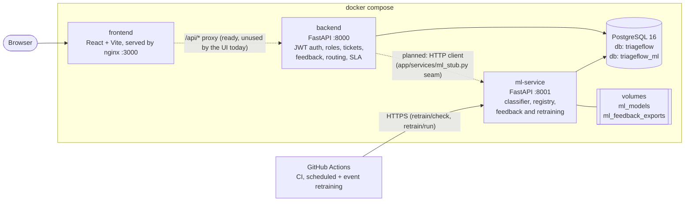
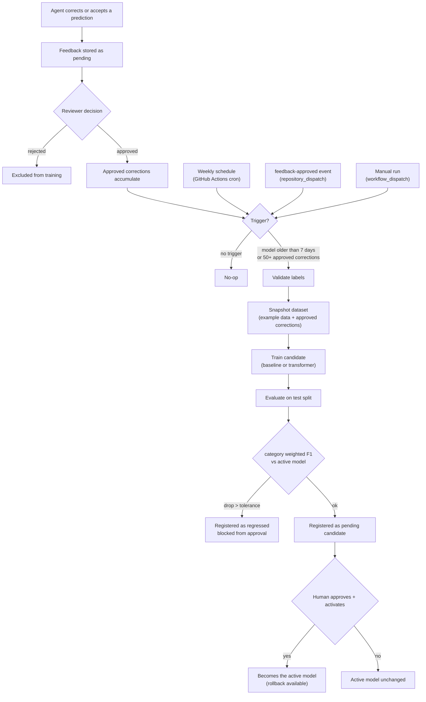

# TriageFlow

**AI-assisted customer-support ticket triage with a human feedback loop and gated model retraining.**

Incoming tickets are classified (category, subcategory, urgency, sentiment), routed to a team, and monitored against SLAs. Agents correct wrong predictions, reviewers approve those corrections, and the approved labels feed a retraining pipeline whose candidate models are compared against the live one and **never promoted without a human decision**.

[](https://github.com/sumerashaikh0920/triageflow/actions/workflows/ci.yml)

| | |
|---|---|
| **Live demo** | `https://YOUR-LIVE-DEMO-URL` *(placeholder: see [docs/DEPLOYMENT.md](docs/DEPLOYMENT.md))* |
| **Source** | https://github.com/sumerashaikh0920/triageflow |
| **API docs (local)** | http://localhost:8000/docs (backend) and http://localhost:8001/docs (ML service) |

## Screenshots

> Placeholders. Capture them from the running app and drop the files in `docs/images/`.

| Dashboard | Ticket detail |
|---|---|
|  |  |

| Feedback & retraining | Model metrics |
|---|---|
|  |  |


## Architecture



Dotted lines are wiring that exists but is not used by the application code yet. See [Integration status](#integration-status).

## Integration status

TriageFlow's three services were built and tested independently. Read this before assuming end-to-end behaviour:

| Piece | State today |
|---|---|
| Frontend | Fully working UI on **in-app mock data**. The demo login is a role picker (no password) and no API calls are made. Dev server and Docker image both work. |
| Backend | Complete REST API with JWT auth, role checks, Alembic migrations and tests. Ticket predictions come from a **built-in mock predictor** (`backend/app/services/ml_stub.py`), not from the ML service. |
| ML service | Complete: classifier with heuristic fallback, evaluation, feedback review, model registry, regression guard, retraining pipeline, tests. Runs in the stack but is **not called by the backend yet**. It keeps its own feedback table, separate from the backend's. |

The Docker, CI and retraining layer in this repo is production-ready for what exists. Connecting frontend to backend, and backend to ML service, is the next integration step and is deliberately outside this layer.

## Quick start

Requires Docker with Compose v2.

```bash
git clone https://github.com/sumerashaikh0920/triageflow.git
cd triageflow
cp .env.example .env        # optional locally; every value has a working default
docker compose up --build
```

| Service | URL |
|---|---|
| Frontend | http://localhost:3000 |
| Backend API docs | http://localhost:8000/docs |
| ML service API docs | http://localhost:8001/docs |
| PostgreSQL | `127.0.0.1:5433` (user/password/db from `.env`) |

First start takes a few minutes: the ML image installs PyTorch (CPU build) and the service trains a bootstrap baseline model on its first boot. `docker compose ps` shows every service as `healthy` when ready.

```bash
docker compose logs -f backend      # follow one service
docker compose down                 # stop, keep data
docker compose down -v              # stop and delete all data volumes
```

### Run services without Docker

```bash
# Backend (needs a PostgreSQL database; point DATABASE_URL in backend/.env at it)
cd backend && python -m venv .venv && source .venv/bin/activate
pip install -r requirements.txt && cp .env.example .env
alembic upgrade head && python -m app.seed && uvicorn app.main:app --reload --port 8000

# ML service
cd ml-service && python -m venv .venv && source .venv/bin/activate
pip install -r requirements.txt && uvicorn app.main:app --reload --port 8001

# Frontend
cd frontend && npm install && npm run dev        # http://localhost:5173
```

Each service folder also has its own README and a standalone `docker-compose.yml`; the root compose file is the primary way to run everything.

### Tests and checks

```bash
cd frontend   && npm run lint && npm run typecheck && npm test && npm run build
cd backend    && pytest
cd ml-service && pytest
```

CI runs all of the above plus migrations on PostgreSQL, Docker image builds, and a full-stack `docker compose` smoke test. See [CI and automation](#ci-and-automation).

## Demo credentials

Created by the backend seed (`SEED_ON_STARTUP=true`, on by default in the compose file) and valid against the backend API:

| Role | Email | Password |
|---|---|---|
| Admin | `admin@triageflow.dev` | `Password123!` |
| Team lead | `lead@triageflow.dev` | `Password123!` |
| Agent | `agent@triageflow.dev` | `Password123!` |

```bash
curl -s -X POST http://localhost:8000/auth/login \
  -H 'Content-Type: application/json' \
  -d '{"email":"admin@triageflow.dev","password":"Password123!"}'
```

The **web UI** does not use these yet: its login screen simply asks you to pick Agent, Team Lead or Admin. These passwords are public. Change them (or set `SEED_ON_STARTUP=false`) before exposing a backend to the internet.

## Roles

| Role | Intended for | Backend permissions (enforced) |
|---|---|---|
| **Agent** | Handling assigned tickets | Sign in, work tickets, submit feedback (accept / correct category / mark urgency), read dashboards, routing queue, SLA, teams, integrations, model metrics. |
| **Team lead** | Running a team's queue | Everything an agent can, plus list users and create or edit routing rules. |
| **Admin** | Running the workspace | Everything a team lead can, plus edit users, create or edit teams, edit integrations, read and change workspace settings. |

## API overview

### Backend (`http://localhost:8000`)

| Method | Path | Access | Purpose |
|---|---|---|---|
| GET | `/health`, `/ready` | public | Liveness; readiness including DB check |
| POST | `/auth/login`, `/auth/refresh` | public | Obtain and refresh JWTs |
| GET | `/auth/me` | any user | Current user |
| GET / POST | `/tickets` | any user | Paginated list with filters; create |
| GET / PATCH | `/tickets/{id}` | any user | Detail; update |
| POST | `/tickets/{id}/assign`, `/status`, `/messages` | any user | Assign, change status, add message |
| GET | `/tickets/{id}/history` | any user | Audit trail |
| GET | `/feedback` | any user | List feedback corrections |
| POST | `/feedback/correct-category`, `/mark-urgency`, `/accept-prediction` | any user | Record a human judgement on a prediction |
| GET | `/dashboard/summary` | any user | Overview numbers |
| GET | `/routing/queue`, `/routing/rules` | any user | Queue and rules |
| POST / PATCH | `/routing/rules`, `/routing/rules/{id}` | admin, team lead | Manage rules |
| GET | `/sla/monitor`, `/sla/events` | any user | SLA status and breach events |
| GET | `/models/versions`, `/models/metrics` | any user | Model versions and metrics shown in the UI |
| GET | `/teams` | any user | List teams |
| POST / PATCH | `/teams`, `/teams/{id}` | admin | Manage teams |
| GET | `/users` | admin, team lead | List users |
| GET | `/users/{id}` | any user | One user |
| PATCH | `/users/{id}` | admin | Edit a user |
| GET | `/integrations` | any user | List integrations |
| PATCH | `/integrations/{id}` | admin | Edit an integration |
| GET / PATCH | `/settings` | admin | Workspace settings |

### ML service (`http://localhost:8001`)

> These endpoints have **no authentication**. The compose file binds the port to `127.0.0.1`; never expose it publicly without a gateway ([docs/DEPLOYMENT.md](docs/DEPLOYMENT.md)).

| Method | Path | Purpose |
|---|---|---|
| POST | `/predict` | Classify a ticket (`subject`, `body`) into category, subcategory, urgency, sentiment, with confidences, routing team and model version |
| GET | `/health` | Status, database check, active model version |
| POST | `/feedback` | Record a prediction and the human correction (starts as `pending`) |
| GET | `/feedback` | List feedback |
| POST | `/feedback/{id}/review` | Mark feedback `approved` or `rejected` |
| GET | `/models` | Registry of all model versions with metrics and status |
| GET | `/models/active` | Currently deployed model |
| POST | `/models/{version}/approve` | Approve a candidate (refused if it regressed) |
| POST | `/models/{version}/activate` | Deploy an approved candidate (refused if it regressed) |
| POST | `/models/{version}/rollback` | Return to a previous model |
| POST | `/retrain/check` | Evaluate retraining triggers without training |
| POST | `/retrain/run?mode=baseline\|transformer&force=false` | Run the pipeline and register a candidate |

## ML metrics

Computed per label field (**category, subcategory, urgency, sentiment**) on a held-out test split, by `ml-service/app/training/evaluate.py`:

| Metric | Meaning |
|---|---|
| **Accuracy** | Share of tickets whose predicted label exactly matches the true label. |
| **Weighted F1** | F1 (harmonic mean of precision and recall) per label, averaged weighted by how many examples each label has. Rewards getting common classes right without hiding failures on rare ones. |
| **Per-label F1** | The same F1 for each individual label, to spot a weak class. |
| **Confusion matrix** | Rows are true labels, columns are predictions; shows which labels get mistaken for which. |
| **Confidence stats and histogram** | Mean, min, max and a 5-bucket histogram of the model's confidence. Used to judge calibration and where to gate auto-routing. |
| **Latency (ms)** | Per-prediction mean, p50, p95 and max. p95 is the time 95% of predictions beat. |
| **Primary metric: `category_weighted_f1`** | The headline number. A candidate whose value drops by more than `RETRAIN_REGRESSION_TOLERANCE` (default 0.01) versus the active model is flagged as a **regression** and cannot be approved or activated. |

## Retraining flow



Key properties:

- **Two triggers, either is enough:** active model at least 7 days old, or at least 50 approved and not-yet-exported corrections (both configurable). The ML service decides; the workflows only ask it. A weekly trigger with no approved corrections ends as a no-op with an explanatory message.
- **Nothing auto-deploys.** The workflows stop at "pending candidate" and print a summary with the next step.
- **Regression guard** is enforced by the registry, not just reported.
- The `transformer` mode downloads a pretrained model on first use and is much heavier than `baseline`.

## CI and automation

| Workflow | Trigger | What it does |
|---|---|---|
| `ci.yml` | push to `main`, PRs, manual | **Frontend:** lint, typecheck, tests, build. **Backend:** pytest with coverage, then Alembic migrations and seed on a real PostgreSQL service. **ML:** pytest (CPU-only torch). **Docker:** builds all three images. **Smoke:** `docker compose up --wait`, then checks login, prediction, and the frontend. |
| `retrain-scheduled.yml` | Mondays 03:00 UTC, manual (`workflow_dispatch` with mode and force options) | Asks the ML service whether to retrain; if so, trains a candidate. |
| `retrain-on-feedback.yml` | `repository_dispatch` event `feedback-approved`, manual | Same pipeline, started when reviewers approve a batch of corrections. Send the event with `scripts/notify_feedback_approved.sh`. |
| `retrain-reusable.yml` | called by the two above | Shared logic. With the `ML_SERVICE_URL` secret it targets your deployed ML service; without it, it runs a self-contained dry run in the runner. |

Setup details for the secrets and the event sender are in [docs/DEPLOYMENT.md](docs/DEPLOYMENT.md#github-actions-setup).

## Configuration

Copy [`.env.example`](.env.example) to `.env`. It documents every variable (database, JWT, CORS, seeding, retraining thresholds, ports) and contains no real secrets. Key points:

- `JWT_SECRET` and `POSTGRES_PASSWORD` must be changed for any public deployment.
- `CORS_ORIGINS` must list your deployed frontend origin.
- `DATABASE_URL` for the backend must use the `postgresql+psycopg2://` scheme.

## Deployment

[docs/DEPLOYMENT.md](docs/DEPLOYMENT.md) covers a one-VM deployment with Docker Compose and Caddy (HTTPS), and a split free-tier route (static frontend host, containerised backend with managed Postgres, optional ML service), plus a security checklist.

## Repository layout

```
.
├── docker-compose.yml          # primary full-stack command
├── .env.example                # documented configuration, no secrets
├── .github/workflows/          # ci, retrain-scheduled, retrain-on-feedback, retrain-reusable
├── frontend/                   # React + TypeScript + Vite (Dockerfile + nginx config)
├── backend/                    # FastAPI + PostgreSQL + Alembic
├── ml-service/                 # FastAPI classifier, registry, retraining
├── deploy/postgres/            # first-boot DB init (creates the ML database)
├── scripts/                    # retrain_via_api.sh, notify_feedback_approved.sh
└── docs/                       # DEPLOYMENT.md, screenshots
```

## License

See [LICENSE](LICENSE).
